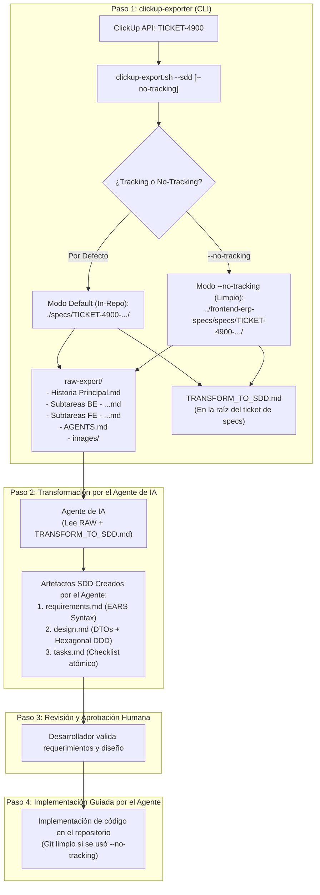

# Flujo de Trabajo Versátil: De ClickUp Exporter a Spec-Driven Development (SDD)

Este documento define la propuesta integral y la especificación de diseño para incorporar un flujo de **Spec-Driven Development (SDD)** sobre las salidas de **ClickUp Exporter**.

---

## 1. Principio Fundamental: Desacoplamiento entre Extracción e Inteligencia

> [!IMPORTANT]
> **El exporter NO genera directamente los archivos `requirements.md`, `design.md` ni `tasks.md`.**  
> La responsabilidad del script CLI es la **ingesta de datos y preparación del espacio de trabajo** (organización de carpetas, descarga de tickets, contratos de API, imágenes y reglas arquitectónicas).  
> Cuando se pasa el flag `--sdd`, el exporter prepara la estructura y proporciona las directivas necesarias para que el **Agente de IA (Cursor, Antigravity, Claude Code)** realice la **transformación inteligente** del material exportado a la especificación formal SDD.



---

## 2. Filosofía de Versatilidad: Tracking vs. `--no-tracking`

El flujo ofrece flexibilidad para adaptarse a las políticas de cada equipo:

| Dimensión | Modo por Defecto (`Project Tracking`) | Modo Aislado (`--no-tracking`) |
| :--- | :--- | :--- |
| **Ubicación de Salida** | `./specs/<story>/` dentro del proyecto de código | `../<proyecto>-specs/specs/<story>/` (o `--specs-dir <ruta>`) |
| **Estado de Git en el Proyecto** | Los archivos exportados y specs se rastrean en Git | El repositorio de código permanece **100% limpio** (zero specs en Git) |
| **Caso de Uso Ideal** | Monorrepos o proyectos con seguimiento unificado en PR | Proyectos multi-repo (FE vs. BE) o políticas que prohíben specs en producción |
| **Interacción con IDE** | Un solo proyecto abierto en el editor | Espacio de trabajo multi-root (`.code-workspace`) o symlink con `.git/info/exclude` |

---

## 3. Especificación de Comandos y Flags del Exporter

Al invocar el exportador con `--sdd`, el comportamiento se adapta según el flag de tracking:

### 3.1 Modo por Defecto: In-Repo Tracking
```bash
./clickup-export.sh TICKET-4900 --sdd
```
* Crea la carpeta dentro del proyecto: `./specs/TICKET-4900 - PL2 - Integraciones - Conector de datos - ERP - Marcas/`.
* Descarga el material en `raw-export/` (historia principal, subtareas `FE` y `BE`, `images/`, `AGENTS.md`).
* Genera la plantilla de directiva `TRANSFORM_TO_SDD.md` para instruir al agente de IA.

### 3.2 Modo Aislado: `--no-tracking` (Repositorio Limpio)
```bash
./clickup-export.sh TICKET-4900 --sdd --no-tracking
```
* Detecta el nombre del repositorio actual (ej. `frontend-erp`).
* Desvía toda la salida hacia el directorio externo:  
  `../frontend-erp-specs/specs/TICKET-4900 - PL2 - Integraciones - Conector de datos - ERP - Marcas/`.
* El repositorio de código fuente no sufre alteraciones ni adiciones en `git status`.

### 3.3 Opciones Complementarias
* `--specs-dir <ruta>`: Especifica manualmente la ruta del directorio de specs (ej. `~/Developer/enterprise-specs`).
* `--workspace`: Genera automáticamente un archivo `.code-workspace` para abrir simultáneamente el código y las specs en Cursor, Antigravity o VS Code sin mezclar sus ramas de Git.

---

## 4. Estructura de Salida del Exporter (Previo a la Transformación)

Tras ejecutar `./clickup-export.sh TICKET-4900 --sdd [--no-tracking]`, la carpeta de salida queda estructurada así:

```text
<directorio_destino>/TICKET-4900-marcas-erp/
├── raw-export/
│   ├── PL2 - Integraciones - Conector de datos - ERP - Marcas.md  # Requerimientos brutos de ClickUp
│   ├── FE - Componente de pestaña -Marcas-.md                   # Tarea de desarrollo Frontend
│   ├── BE - EP Create.md                                       # Contrato de API: DTOs y status codes
│   ├── BE - EP FindAll.md                                      # Contrato de API: endpoints GET
│   ├── BE - EP Delete.md                                       # Contrato de API: endpoint DELETE
│   ├── PREVIUS TICKET NEEDED ...md                             # Prerrequisito / dependencia
│   ├── AGENTS.md                                               # Reglas DDD, pruebas y Git
│   └── images/                                                 # Mockups y capturas locales
│       ├── image_1.png
│       └── image_2.png
└── TRANSFORM_TO_SDD.md                                         # Directiva generada para el Agente
```

> [!NOTE]
> Observa que **`requirements.md`**, **`design.md`** y **`tasks.md`** aún no existen en este punto. El agente de IA será quien los construya de forma guiada a continuación.

---

## 5. El Rol del Agente de IA: Proceso de Transformación a SDD

Una vez exportados los archivos, el desarrollador inicia la sesión con su asistente de IA (Cursor, Antigravity, Claude Code) ejecutando la directiva de transformación contenida en `TRANSFORM_TO_SDD.md`.

### 5.1 Directiva Generada por el Exporter (`TRANSFORM_TO_SDD.md`)

```markdown
# Directiva de Transformación a Spec-Driven Development (SDD)

Actúa como un Arquitecto de Software y Tech Lead experto en DDD y Angular.
Tu objetivo es analizar los archivos en `raw-export/` y transformarlos en los 3 artefactos formales de SDD:

## Archivos de Entrada:
- Historia principal: `raw-export/PL2 - Integraciones - Conector de datos - ERP - Marcas.md`
- Subtareas Backend: `raw-export/BE - *.md` (solo referencia de contratos y DTOs)
- Subtareas Frontend: `raw-export/FE - *.md` (alcance de implementación)
- Reglas de arquitectura: `raw-export/AGENTS.md`

## Artefactos a Generar:

### 1. `requirements.md`
- Sintetiza la User Story (Rol, Necesidad, Beneficio).
- Define los límites del Alcance ("Incluye" y "No incluye").
- Formula cada requerimiento y regla de validación en sintaxis EARS:
  - *WHEN <condición/evento> THE SYSTEM SHALL <respuesta del sistema>*.
- Identifica casos borde y validaciones de unicidad (ej. relación 1 a 1 entre marcas).

### 2. `design.md`
- Diseña la solución Frontend siguiendo estrictamente la Arquitectura Hexagonal y DDD de `AGENTS.md`:
  - **Dominio:** Entidades (`Marca`, `EquivalenciaMarca`) y Puertos (interfaces de repositorios).
  - **Infraestructura:** Adaptador HTTP consumiendo los endpoints documentados en los archivos `BE - ...` (incluyendo DTOs como `ConectorMarcaErpDTO` y manejo de errores HTTP 400 y 409).
  - **Aplicación:** Casos de uso (`GetEquivalenciasUseCase`, `CreateEquivalenciaUseCase`, etc.).
  - **Presentación:** Componentes Container/Presentational con Signals de Angular y Reactive Forms.
- **Regla Estricta:** NO diseñar pruebas unitarias dentro de `/core`.

### 3. `tasks.md`
- Desglosa la implementación en una lista de tareas atómicas y secuenciales con checkboxes `[ ]`:
  - Fase 1: Modelos de Dominio y Puertos.
  - Fase 2: Adaptadores de Infraestructura y pruebas unitarias (`*.spec.ts`).
  - Fase 3: Casos de Uso y pruebas unitarias.
  - Fase 4: Componentes de UI (Formulario, Tabla y Pestaña principal).
  - Fase 5: Suite de pruebas unitarias y prueba E2E simplificada.

Procede a generar `requirements.md`, `design.md` y `tasks.md` en la raíz de esta carpeta de especificaciones.
```

---

## 6. Resultado Posterior a la Transformación del Agente

Tras la ejecución del agente, el espacio de especificación queda formalmente estructurado y listo para el desarrollo:

```text
<directorio_destino>/TICKET-4900-marcas-erp/
├── requirements.md             # Generado por el Agente (EARS y Reglas de Negocio)
├── design.md                   # Generado por el Agente (Arquitectura DDD + DTOs)
├── tasks.md                    # Generado por el Agente (Checklist de Ejecución)
├── TRANSFORM_TO_SDD.md         # Directiva de transformación inicial
└── raw-export/                 # Fuente de verdad original intacta
    ├── PL2 - Integraciones - Conector de datos - ERP - Marcas.md
    ├── BE - *.md
    ├── FE - *.md
    ├── AGENTS.md
    └── images/
```

---

## 7. Fase de Implementación y Ejecución de Código

Una vez aprobados `requirements.md` y `design.md` por el desarrollador, el agente pasa a la fase de construcción del código:

1. **Lectura Contextual:** El agente lee `tasks.md` y ejecuta la primera tarea pendiente `[ ]`.
2. **Escritura Segura de Código:**
   - Si se usó el **Modo por Defecto**, edita el código en `src/` y las specs en `./specs/`.
   - Si se usó **`--no-tracking`**, edita el código en el repositorio del proyecto pero actualiza los checkboxes `[x]` en la carpeta externa `../<proyecto>-specs/`.
3. **Validación:** Ejecuta las pruebas unitarias y asegura que se cumplan las restricciones de `AGENTS.md` (cero archivos `.spec.ts` en `/core`, pruebas E2E esenciales).
4. **Finalización:** Al completar todas las tareas de `tasks.md`, el feature está listo para PR.

---

## 8. Resumen de Ventajas de este Enfoque

1. **Scripts Livianos y Robustos:** El CLI de ClickUp Exporter se mantiene enfocado en su fortaleza: extraer datos limpios desde ClickUp, resolver jerarquías y descargar adjuntos, sin sobrecargarse de lógica frágil de parsing o regex para generar código o especificaciones complejas.
2. **Máxima Inteligencia vía Agente:** El agente de IA aprovecha su capacidad de razonamiento contextual para interpretar los DTOs de Backend, las restricciones de UI de Frontend y las normas de arquitectura, generando especificaciones de altísima calidad.
3. **Versatilidad de Rastreo:** Los equipos pueden elegir fácilmente con un flag (`--no-tracking`) si desean que las especificaciones viajen en el mismo Git del código o si se aíslan por completo en un repositorio independiente.
